# axum-graphql Architecture

## 1. Purpose and Scope

`axum-graphql` is a minimal demo API that exposes the GraphQL endpoint for a basic
blog back-end. The architecture is documented from the perspective of long-term
stability — we only record the _concepts_ that are unlikely to change here;
infrastructure choices are outlined in the _implementation_ section, below.

## 2. High-Level Architecture

```mermaid
architecture-beta
    group client(internet)["Client Space"]
        service graphql_playground(logos:graphql)["GraphQL Playground / Client"] in client

    group observability(server)["Observability Stack (Docker)"]
        service otel_exporter(logos:opentelemetry-icon)[OTLP Exporter] in observability
        service otel_collector(logos:opentelemetry-icon)[otel Collector] in observability
        service jaeger_collector(logos:gopher)["Jaeger Collector (Traces)"] in observability
        service prometheus(logos:prometheus)["Prometheus (Metrics)"] in observability
        service loki(logos:terminal)["Loki (Logs)"] in observability

    group application(server)["Application Space"]
        service router(server)[Axum Router] in application
        service graphql_handler(logos:graphql)["GraphQL Handler"] in application
        service model(database)["Domain Data Model"] in application

    group persistence(database)["Persistence"]
        service sqlite_db(logos:sqlite)["SQLite DB (File)"] in persistence

    router:R <-- L: graphql_playground
    otel_exporter:R <-- L:router
    otel_exporter:B --> T:otel_collector
    otel_collector:L --> R:prometheus
    loki:L <-- R:otel_collector
    jaeger_collector:T <-- B:otel_collector
    router:B --> T:graphql_handler
    graphql_handler:B --> T:model
    model:R --> L:sqlite_db
```

> **Read‑only diagram** – the arrows represent _dependency_ flows, _not_ data paths.

## 3. Layer Boundaries and Contracts

| Layer             | External Boundary                  | Internal Boundary                                   |
| ----------------- | ---------------------------------- | --------------------------------------------------- |
| **Client**        | HTTP/GraphQL (`/graphql`)          | –                                                   |
| **Application**   | HTTP surface (`axum`)              | Calls **Domain** services                           |
| **Domain**        | Public API                         | Calls **Persistence** repository                    |
| **Persistence**   | Repository interface in data model | Interacts with underlying DB (file, Postgres, etc.) |
| **Observability** | Exporter middleware(OTel)          | Wraps **Application** router                        |

_The diagram above is a visual representation of these boundaries._

## 4. Architectural Invariants

1. **API → Domain → Persistence** – the handler may _only_ call Domain logic;
   Persistence is hidden via a repository interface.
2. **Explicit Dependency Injection** – all components receive dependencies via
   constructors; no globals.
3. **Observability is optional** – the router can be wrapped with or without a
   Tower Layer for OTel; the absence of exporters does not affect
   application flow.
4. **Layered Package Layout** – source files are collocated under
   `src/database`, `src/observability`, `src/model`, etc. No cross‑layer
   modules.

## 5. Implementation‑Specifics (May Change)

| Area                    | Current Choice                                         | Future Variants                                |
| ----------------------- | ------------------------------------------------------ | ---------------------------------------------- |
| **Database**            | SQLite (file‑backed)                                   | PostgreSQL, MySQL, in‑memory mock              |
| **Observability Stack** | Docker Compose with Jaeger, Prometheus, Loki & Grafana | Cloud‑managed OTLP collector, native exporters |
| **GraphQL Library**     | `async-graphql`                                        | Alternative GraphQL runtimes                   |

_These choices are referenced only in this section; the main architecture
remains the same regardless of the underlying stack._

## 6. Future‑Proofing & Migration Path

- **Persistence** – Swapping the DB only requires implementing the repository
  interface; the rest of the layers are untouched.
- **Observability** – Changing exporter hosts or moving to a managed collector
  only changes the configuration of the middleware; no code changes.
- **Deployment** – The Docker Compose file can be replaced with `k8s` manifests
  or a `docker‑stack`; the application does not need to be tweaked.
